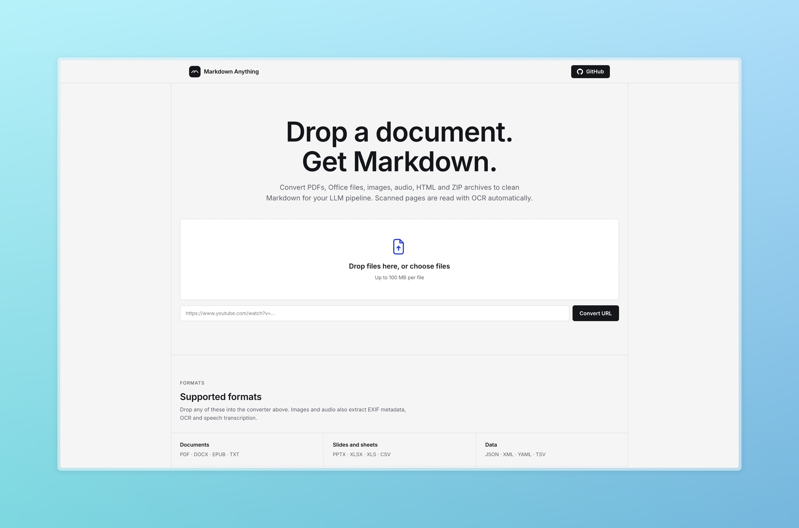

# Markdown Anything

Convert PDF, Office files, images, audio and scanned documents to Markdown. Runs locally in a browser UI, with OCR for scanned pages.



## Features

- Drag and drop conversion of PDF, Word, Excel, PowerPoint, EPUB, HTML, CSV, JSON, XML, TXT, images, audio and ZIP archives
- Web page and YouTube link conversion from a URL bar
- Scanned PDFs are detected and read with local OCR automatically
- Markdown and rendered preview tabs, copy to clipboard, single and batch `.md` download
- Queue with per file status and sizes
- Runs locally; uploaded files are deleted right after conversion

## Quickstart

You need Python 3.10 or newer. One command works on Linux, macOS and Windows.

```bash
python run.py
```

The script creates `.venv` if needed, installs missing packages, picks port 7860 (or the next free one), and serves the app. Open the printed address, usually http://127.0.0.1:7860. The first run also sets up the OCR engine, a several-GB download (see [Scanned PDFs and OCR](#scanned-pdfs-and-ocr)).

On Windows use `python` or the `py` launcher instead of `python3` if needed.

Manual setup, if you prefer:

```bash
python -m venv .venv
.venv/bin/pip install -r requirements.txt   # .venv\Scripts\pip on Windows
.venv/bin/uvicorn app:app --host 127.0.0.1 --port 7860
```

## Scanned PDFs and OCR

Text based documents convert with [MarkItDown](https://github.com/microsoft/markitdown). A PDF with almost no text layer is treated as a scan and re-read with a local [MinerU](https://github.com/opendatalab/MinerU) OCR engine, marked with an OCR badge in the output header.

On its first run `python run.py` installs MinerU automatically into `~/mineru-env`, downloads the OCR models (several GB), enables local mode, and starts the server. Later runs reuse that install. If the install or download fails, the app still starts and scanned PDFs convert through the fast path only.

To install OCR by hand instead, or into a different location:

```bash
pip install mineru
mineru-kit models download --tier standard
mineru config set parse_server.local.mode managed
```

`run.py` finds the binary at `MINERU_BIN`, `~/mineru-env/bin/mineru`, or on `PATH`. If the server is still warming up or unavailable, the app converts with the fast path and notes it in the server log.

## Configuration

| Variable    | Default                        | Purpose                                  |
| ----------- | ------------------------------ | ---------------------------------------- |
| `PORT`      | `7860`                         | Preferred port, next free one is used    |
| `MINERU_BIN`| `~/mineru-env/bin/mineru`      | MinerU binary for the OCR fallback       |

Uploads are limited to 100 MB per file.

## API

| Endpoint            | Purpose                                  |
| ------------------- | ---------------------------------------- |
| `GET /`             | Browser interface                        |
| `POST /api/convert` | Convert one uploaded file, `file` field  |
| `POST /api/convert-url` | Convert a web page or YouTube URL, `{"url": ...}` |

`/api/convert` returns `{"name": ..., "markdown": ..., "engine": ...}` where `engine` is `markitdown` or `mineru-ocr`. `/api/convert-url` returns `{"name": ..., "markdown": ...}`.

## Project layout

```text
app.py              FastAPI app, conversion and OCR fallback
run.py              Cross platform launcher (Linux, macOS, Windows)
requirements.txt    Python dependencies
static/index.html   Page markup and SEO tags
static/style.css    Styling with the [structural grid](https://skills.nabinkhair.com.np/skills/structural-grid) system, Inter only
static/app.js       Queue, conversion, preview, download logic
```

## License

Released under the MIT License. See `LICENSE`.

Built on [microsoft/markitdown](https://github.com/microsoft/markitdown) and [MinerU](https://github.com/opendatalab/MinerU). Developed by [Nabin Khair](https://nabinkhair.com.np).
